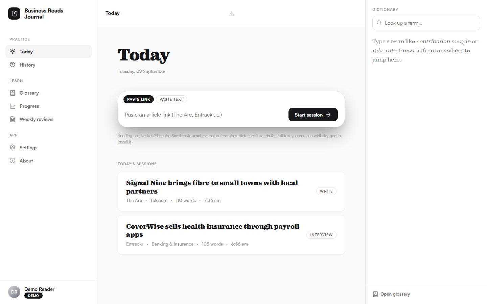
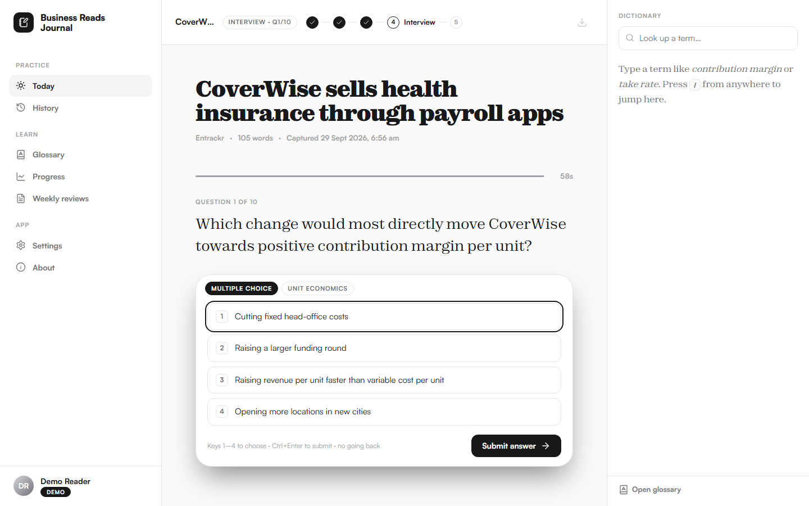
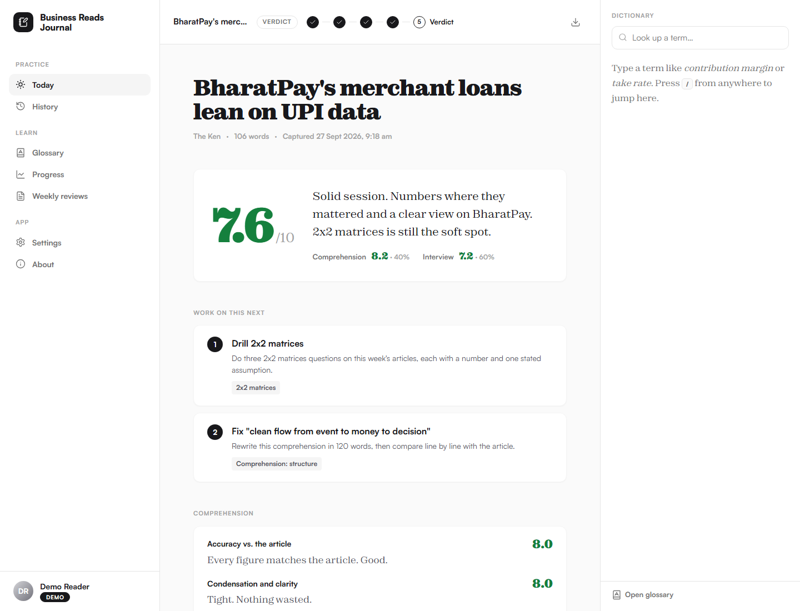
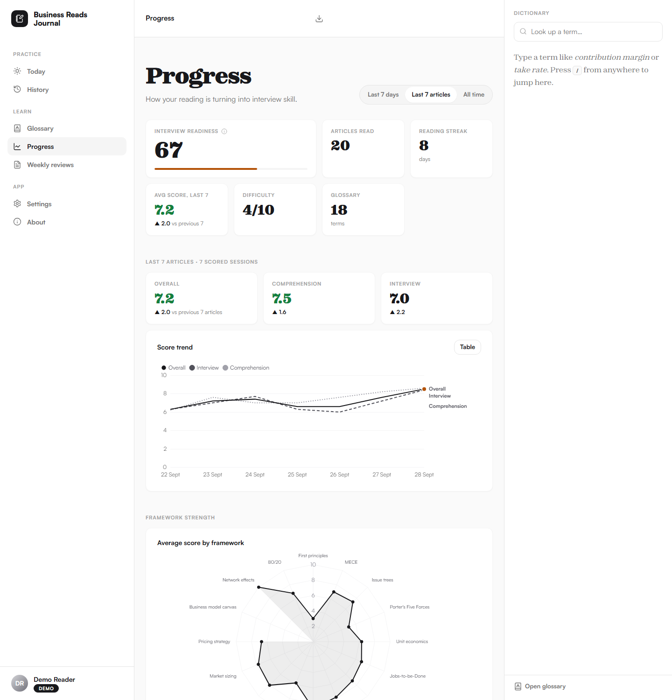
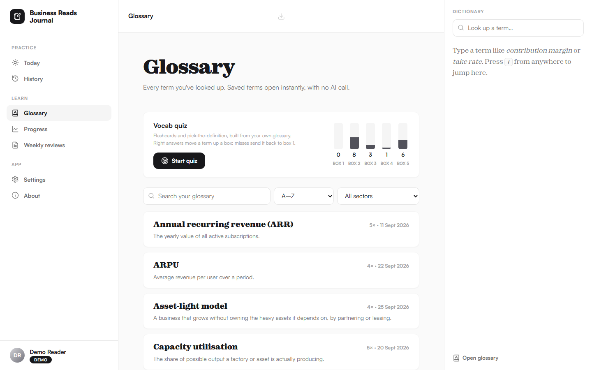
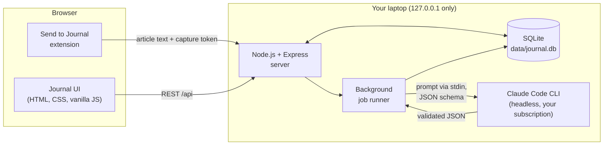

# Business Reads Journal

**Turn daily business reading into deliberate practice for Chief of Staff and Founder's Office interviews, with an AI interviewer that doesn't round up to be kind.**

A local-first web app. You read The Ken, The Arc or Entrackr as usual; the journal makes you condense each article, pull a few threads, then sit a timed 10-question interview scored by a deliberately tough AI interviewer. Everything runs on your own laptop, with your own Claude subscription.



> Screenshots come from demo mode (`npm run demo`), which uses fictional companies and articles.

---

## The daily loop

| Stage | What you do | What the app does |
|---|---|---|
| **1. Add** | Read an article on the original site, click **Send to Journal** | Captures the text from your logged-in tab and tags it (companies, sector, business model, themes) |
| **2. Write** | Condense it in 100–200 words: what happened, why it matters, how the money works, your take | Locks it on submit and starts writing your interview questions in the background |
| **3. Explore** | Follow 3–5 suggested threads | Gives specific topics with Google search links (never made-up URLs) |
| **4. Interview** | Answer 10 questions, 60 seconds each, no going back | Multiple choice, short answer, MECE breakdowns and estimations, each tagged with a framework |
| **5. Verdict** | Read the feedback | A score out of 10 (40% comprehension, 60% interview), a model answer beside every answer, and two things to work on next |

Optional **extra rounds** (Easy to Super hard) add more practice without changing the session score.

| Interview | Verdict |
|---|---|
|  |  |

## Why a tough interviewer

Generous feedback feels good. Honest feedback is what prepares you. The evaluator is modelled on a demanding Chief of Staff interviewer: short sentences, no compliments unless earned, and it calls out vague thinking, missing numbers and lists that aren't MECE. It is harsh on the work, never on the person.

It's calibrated so scores mean something:

- **5/10** is an acceptable first-round answer.
- **8+** needs specific numbers, a clear structure *and* a non-obvious insight.
- **10** almost never appears. Scores are never rounded up.

Difficulty adapts: after five scored sessions, the level (1–10) moves up when your last five interview scores average 7+, and down at 4 or below.

## Features

- **One-click capture** with a Manifest V3 browser extension (Chrome and Edge). Works with paywalled articles you can read while logged in; the app itself never logs in or scrapes.
- **Background AI work** so you rarely wait: tagging and related reading start at capture; questions are written while you explore.
- **Timed interview** with a server-side clock (reloading doesn't buy time), auto-submit at zero, and keyboard shortcuts.
- **Dictionary panel** on every page. Look up a term once (definition, formula, Indian and global examples, why it matters); every repeat lookup comes from your glossary instantly, with no AI call.
- **Vocab quiz** built from your own glossary: flashcards and pick-the-definition, on a 5-box Leitner schedule.
- **Progress dashboard**: interview readiness index (with its formula), score trends, framework radar, weakest frameworks, sector coverage (and sectors you've never read), difficulty over time, vocabulary growth.
- **Weekly reviews** after every 7 sessions or 7 days: what improved (with numbers), what's still weak, patterns and three goals.
- **PDF reports**: session, weekly review, and an all-time portfolio report.
- **Backup and restore**, and a **demo mode** with fictional data.
- **No reminders, notifications or streak nudges.** Ever.

| Progress | Glossary |
|---|---|
|  |  |

## Architecture



- **Server:** Express 5 bound to `127.0.0.1` (unreachable from other devices), with a Host-header guard.
- **Database:** SQLite via `better-sqlite3` (falls back to Node's built-in `node:sqlite`), versioned SQL migrations.
- **Frontend:** plain HTML, CSS and ES modules. No framework, no build step. Chart.js and Lucide icons are vendored, so everything works offline except the AI calls.

## How AI is used

All AI work goes through one module, [`server/ai/claudeBridge.js`](server/ai/claudeBridge.js), which runs the **Claude Code CLI in headless mode**:

- **Your subscription, never an API key.** `ANTHROPIC_API_KEY` is stripped from the child process, so nothing is ever billed to a key.
- **Prompts go in through stdin**, so 20,000-character articles work on Windows (which limits command lines to about 8,000 characters).
- **Every response is validated.** Each prompt has a zod schema, sent to the CLI as `--json-schema` and checked again on arrival. One automatic retry, then one "return valid JSON only" repair attempt, then a friendly error with a Retry button.
- **Contained.** All tools are disabled and the CLI runs in an empty folder, so it can only return text.
- **Rate-limited.** At most 2 calls at a time, with 120s (light model) and 240s (strong model) timeouts, and every call logged.
- **Latency is hidden** by starting work early (tagging and related reading at capture, questions at submit) and by skeleton loaders on every wait.
- **The app, not the model, does the arithmetic.** Multiple-choice and blank answers are scored by the app, and all totals and weightings are computed on the server.

A lighter model handles tagging and dictionary lookups; a stronger one handles questions, evaluation and weekly reviews. Both are set in [`config.json`](config.json).

## Privacy by design

- **Local only.** Your journal lives in `data/journal.db` on your laptop. `/data` is gitignored and never committed.
- **No scraping, no logins.** Articles come from your own browser tab, only when you click the extension. The app never stores passwords.
- **Paid content stays private.** Article text is used only to ground the AI's evaluation. It never appears in the UI, reports, screenshots or this repo.
- **Locked-down capture.** The capture endpoint needs a secret token and accepts only the paired browser extension.

## Setup (Windows)

1. **Install [Node.js](https://nodejs.org) LTS** and **[Git](https://git-scm.com)**.
2. **Install Claude Code** and log in with your Claude account (a Pro or Max subscription). In PowerShell:
   ```powershell
   irm https://claude.ai/install.ps1 | iex
   & "$env:USERPROFILE\.local\bin\claude.exe" auth login
   ```
   Logging in to the Claude desktop app isn't enough; the command-line tool keeps its own login.
3. **Get the code:**
   ```
   git clone https://github.com/anshullmishra-png/business-reader-ai-journal.git
   ```
4. **Double-click `start.bat`.** The first launch installs dependencies and downloads the fonts, then opens http://127.0.0.1:4317.
5. **Install the extension:** in the app, open **Settings → How to install the extension** and follow the steps (Load unpacked from the `extension` folder, then paste your capture token).

From a terminal instead: `npm install`, then `npm start`.

| Command | What it does |
|---|---|
| `npm start` | Runs the journal |
| `npm run demo` | Runs a separate demo journal (`data/demo.db`) seeded with 20 fictional sessions |
| `npm run demo:reset` | Rebuilds the demo journal from scratch |
| `npm run ai:smoke` | Checks the Claude Code bridge end to end |

**Backups:** Settings → Backup exports a single `.db` file and can restore one; your current journal is saved to `data/backups` first.

> This app is for personal, local use with your own Claude subscription. It isn't a hosted service.

## Roadmap

- [ ] Highlight-to-lookup: select a word on the article page and send it to the dictionary
- [ ] Spaced repetition for interview frameworks, not just vocabulary
- [ ] Mock "case" mode: one article, a 20-minute structured case discussion
- [ ] Optional voice answers for the interview stage
- [ ] Import reading history from a notes app

## What I learned

> _Placeholder: fill in after a few weeks of use._
>
> - _What changed in how I read business news_
> - _Which frameworks were hardest, and what fixed them_
> - _What designing a "tough but fair" AI evaluator taught me about prompts and calibration_
> - _Trade-offs of running AI locally via a CLI instead of an API_

## Credits

- Fonts: [Satoshi and Zodiak](https://www.fontshare.com) by Indian Type Foundry (downloaded on first run under the ITF Free Font License; not redistributed here).
- [Chart.js](https://www.chartjs.org), [Lucide](https://lucide.dev) icons, [Mozilla Readability](https://github.com/mozilla/readability), [jsdom](https://github.com/jsdom/jsdom), [zod](https://zod.dev).
- AI engine: [Claude Code](https://claude.com/claude-code) by Anthropic.

Licensed under the [MIT License](LICENSE).
