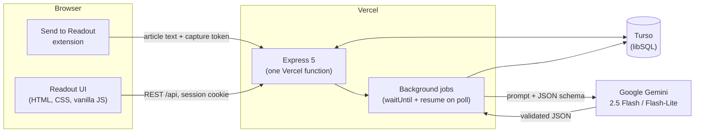

# Readout

**Daily business reading, interview-ready. Read it. Brief it. Defend it.**

Readout turns the business article you read each morning into practice for Chief of Staff and Founder's Office interviews. You condense the article, pull a few threads, then sit a timed 10-question interview scored by a deliberately tough AI interviewer that doesn't round up to be kind.

It's a hosted web app: each reader signs up with an invite code and gets a private account.

---

## The daily loop

One new article per person per day. The limit keeps each session deliberate and the questions demanding.

| Stage | What you do | What Readout does |
|---|---|---|
| **1. Add** | Read an article on the original site, click **Send to Readout**, or paste a link or the text | Captures the text and tags it (companies, sector, business model, themes) |
| **2. Write** | Condense it in 100–200 words: what happened, why it matters, how the money works, your take | Locks it on submit and writes your interview questions in the background |
| **3. Explore** | Follow 3–5 suggested threads | Gives specific topics with Google search links (never made-up URLs) |
| **4. Interview** | Answer 10 questions, 60 seconds each, no going back | Multiple choice, short answer, MECE breakdowns and estimations, each tagged with a framework |
| **5. Verdict** | Read the feedback | A score out of 10 (40% comprehension, 60% interview), a model answer beside every answer, and two things to work on next |

Optional **extra rounds** (Easy to Super hard) add practice without changing the session score.

## Why a tough interviewer

Generous feedback feels good. Honest feedback is what prepares you. The evaluator is modelled on a demanding Chief of Staff interviewer: short sentences, no compliments unless earned, and it calls out vague thinking, missing numbers and lists that aren't MECE. It is harsh on the work, never on the person.

- **5/10** is an acceptable first-round answer.
- **8+** needs specific numbers, a clear structure *and* a non-obvious insight.
- **10** almost never appears. Scores are never rounded up.

Difficulty adapts: after five scored sessions, the level (1–10) moves up when your last five interview scores average 7+, and down at 4 or below.

## Features

- **Send to Readout** browser extension (Chrome and Edge, Manifest V3) for paywalled articles you can read while logged in. Readout itself never logs in or scrapes.
- **Background AI work** so you rarely wait: tagging and related reading start at capture; questions are written while you explore.
- **Timed interview** with a server-side clock (reloading doesn't buy time) and auto-submit at zero.
- **Dictionary drawer** on every page; repeat lookups come from your glossary with no AI call.
- **Vocab quiz** from your own glossary on a 5-box Leitner schedule.
- **Progress dashboard**, **weekly reviews**, and **PDF reports** (session, weekly review, portfolio).
- **No reminders, notifications or streak nudges.**

## Architecture

- **Server:** Express 5 exported as a single Vercel function ([`api/index.js`](api/index.js)); locally, [`server/local.js`](server/local.js) serves the same app.
- **Database:** Turso (libSQL) in production, a local SQLite file in development; versioned migrations in [`server/db/schema.js`](server/db/schema.js).
- **Accounts:** email and password (scrypt), httpOnly session cookie, sign-up gated by an invite code.
- **Frontend:** plain HTML, CSS and ES modules. No framework, no build step.

## How AI is used, and what it costs

All AI calls go through [`server/ai/gemini.js`](server/ai/gemini.js):

- **Every response is validated** against a zod schema (sent to Gemini as the response JSON schema, then checked again), with one transport retry and one "return valid JSON only" repair.
- **Two models:** Flash-Lite for tagging and dictionary lookups; Flash, with thinking left on, for related reading, questions, scoring and weekly reviews.
- **Real usage is logged.** Every call records Gemini's input, output and thinking token counts and its cost at Google's paid rates. Settings shows each reader's tokens and cost today, and the app's spend against its daily budget.
- **Spending is capped three ways:** one new article per person per day, at most 30 AI calls per person per day, and an app-wide daily budget (default $0.50). When the budget is used up, new articles and AI calls pause until midnight UTC.

One article end to end costs about **$0.045** (most of it is the questions and scoring on Flash). With the default budget, $5 of prepaid credit lasts at least ten days at full use by eleven readers.

## Setup

**Hosted (Vercel):** set these environment variables on the project (see [`.env.example`](.env.example)):

| Variable | What it is |
|---|---|
| `TURSO_DATABASE_URL`, `TURSO_AUTH_TOKEN` | The Turso database |
| `GEMINI_API_KEY` | Google AI Studio API key |
| `INVITE_CODE` | The code friends need to create an account |
| `ARTICLES_PER_DAY` | New articles per person per day (default 1) |
| `APP_DAILY_BUDGET_USD` | App-wide Gemini spend per day (default 0.50) |
| `AI_DAILY_LIMIT` | AI calls per person per day (default 30) |

**Locally:** Node.js 22+, then `npm install`, a `.env.local` with the variables above (the Turso ones are optional: without them a local SQLite file in `data/` is used), and `npm run dev`. On Windows, double-clicking `start.bat` does the same. Readout opens on http://localhost:4317.

**Extension:** in Readout, open **Account → Browser extension**, download the zip, then Load unpacked in `chrome://extensions` and paste your capture token. After changing the extension, run `npm run pack-extension` to rebuild the zip.

## Privacy

- **Private accounts.** Every query is scoped to the signed-in reader; nobody sees anyone else's writing or scores.
- **No scraping, no logins.** Paywalled articles come from your own browser tab, only when you click the extension.
- **Article text stays on the server.** It grounds the questions and the evaluation and is never sent back to the browser.
- **Locked-down capture.** The capture endpoint needs a per-reader token and accepts only the paired extension.

## Credits

- Type: [Archivo](https://fonts.google.com/specimen/Archivo) and [IBM Plex Mono](https://fonts.google.com/specimen/IBM+Plex+Mono) via Google Fonts.
- [Chart.js](https://www.chartjs.org), [Lucide](https://lucide.dev) icons, [Mozilla Readability](https://github.com/mozilla/readability), [jsdom](https://github.com/jsdom/jsdom), [zod](https://zod.dev), [libSQL](https://github.com/tursodatabase/libsql-client-ts), [Google Gen AI SDK](https://github.com/googleapis/js-genai).

Licensed under the [MIT License](LICENSE).
